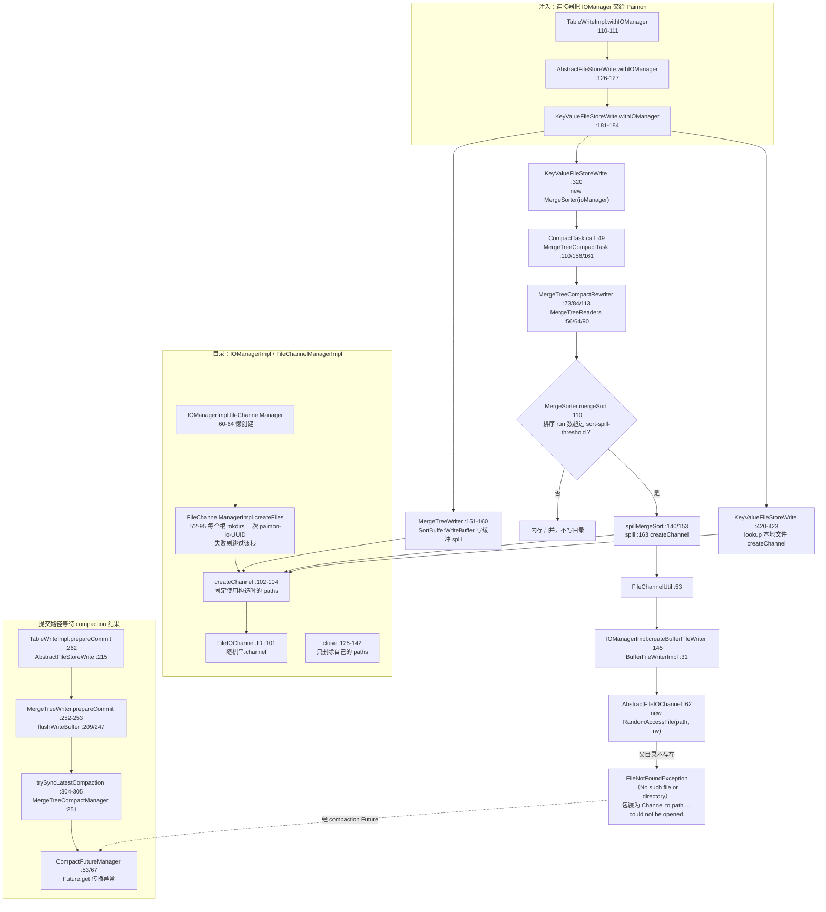
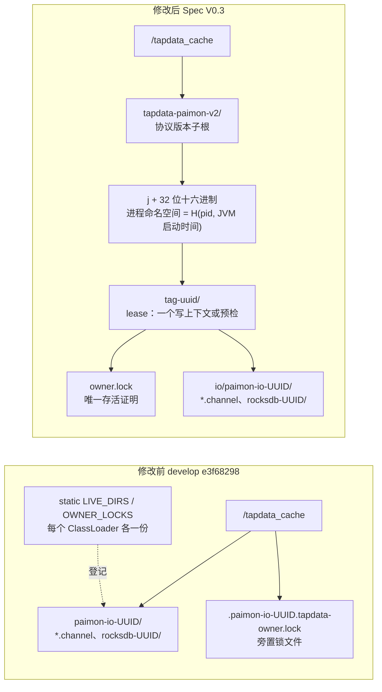
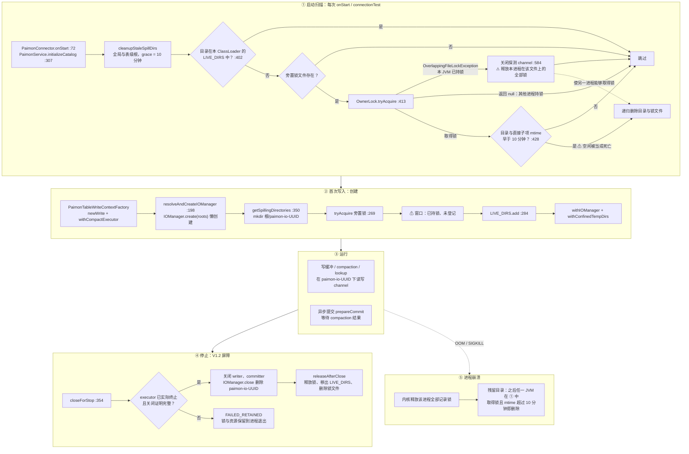
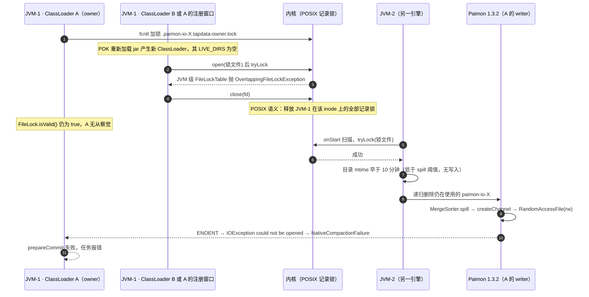
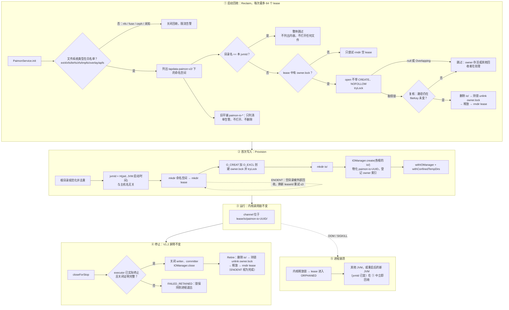
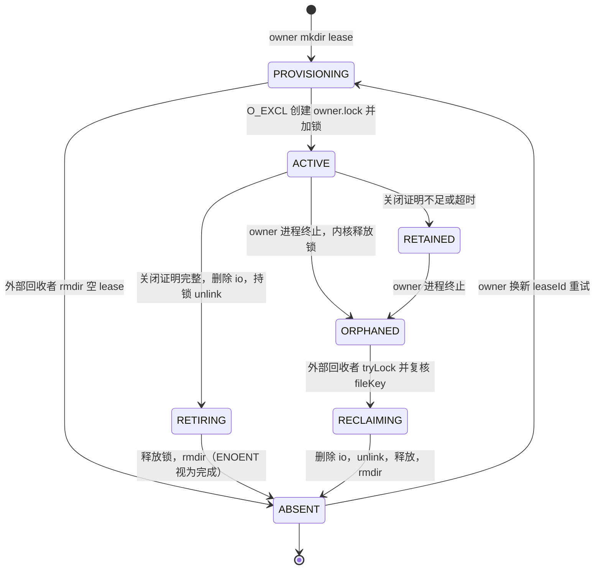
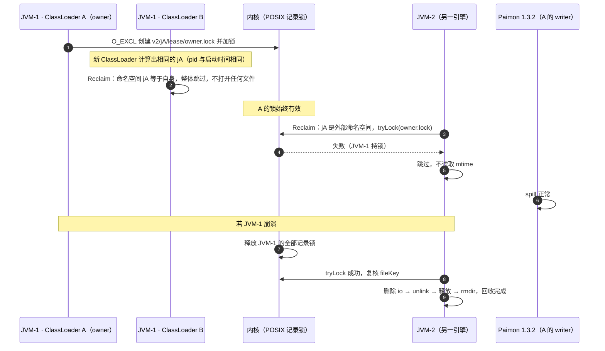

# Paimon Spill 所有权隔离：修改前后对比与完整生命周期

> 日期：2026-11-12。“修改前”指 develop `e3f68298` 的实现；“修改后”指 [SPEC V0.3](../specs/SPEC-paimon-spill-owner-isolation.md) 规定的协议，**尚未实现**。\
> 内核基线：Paimon `release-1.3.2`（`c05f7d1f`）；Maven `paimon-core-1.3.2-sources.jar` 与该标签的相关文件逐字节一致。\
> STOP 两阶段停止、取消与 FAILED_RETAINED 的细节见 9 月文档 [SPILL-修复前后对比与生命周期总览](SPILL-修复前后对比与生命周期总览.md)。本文聚焦**目录所有权与回收**，这一部分是本次改动的全部范围。\
> 逐条证据与评审处置见 [REVIEW-paimon-spill-owner-isolation-2026-11-12](REVIEW-paimon-spill-owner-isolation-2026-11-12.md)。

## 1. 改什么、不改什么

| 不变（V1.2 与 Paimon 内核） | 改变（目录所有权） |
| --- | --- |
| Paimon 内核的 spill 调用链（§2） | spill 根目录布局 |
| 连接器自有 compaction executor 与终止证明屏障 | 存活证明：从“static 登记 + 旁置锁 + mtime”改为“仅 OS 记录锁” |
| STOP 两阶段、取消来源桥接、FAILED_RETAINED | 同 JVM 保护：从“按 ClassLoader 的 LIVE_DIRS”改为“按进程命名空间目录名排除” |
| 提交 / pending / offset 语义 | 跨进程回收：取消时间判断；增加 fileKey 复核、文件系统准入、预算 |
| `withConfinedTempDirs` 把 RocksDB 约束在 spill 目录内 | 引擎级审计 |

## 2. Paimon 1.3.2 内核中的 Spill 调用链（修改前后相同）

据此可以得出三点：

1. 目录只在 IOManager 首次使用时创建一次（`:60-64`、`:72-95`），之后不再 mkdirs（`:102-104`）。目录一旦被删，该 IOManager 的每次 spill 都会失败（PR #2 C10）。
2. compaction 只有在排序 run 数超过 `sort-spill-threshold` 时才写目录（`MergeSorter:110`），所以活跃 writer 的目录可以长时间没有任何修改。用 mtime 判断“已失效”在内核层面就不成立。
3. 失败会经 compaction Future 传到 `prepareCommit`，与现场栈逐帧一致（证据 §2.1）。

## 3. 目录布局对比

## 4. 修改前的完整生命周期

## 5. 修改前的故障时序（现场 ENOENT，已由 PR #2 R1/R2 复现）

## 6. 修改后的完整生命周期

## 7. 修改后的租约状态机

## 8. 修改后同一场景的时序

## 9. 修改前后逐项对比

| 维度 | 修改前（develop） | 修改后（Spec V0.3） | 依据 |
| --- | --- | --- | --- |
| 目录布局 | 根下平铺 `paimon-io-UUID` 与旁置锁文件 | `tapdata-paimon-v2/<jvmId>/<tag>-<uuid>/{owner.lock, io/}` | Spec §4.1 |
| 归属粒度 | 只有 IOManager 目录，不含进程与表信息 | 进程命名空间 + 表级 lease | Spec §4.1 |
| 存活证明 | static LIVE_DIRS（按 ClassLoader）+ 旁置锁 + mtime ≥ 10 分钟 | 只认 OS 记录锁 | INV-03；`MergeSorter:110` 说明空闲不等于死亡 |
| 同 JVM 保护 | 依赖本 ClassLoader 的 LIVE_DIRS；跨 ClassLoader 与注册窗口都会探测并丢锁 | 按目录名排除本 jvmId，打开任何文件之前完成 | INV-01；PR #2 C1、R1、R2 |
| 进程身份 | 无 | H(pid, JVM 启动时间)，与主机名无关 | Spec §4.2；PR #2 C3 |
| 创建竞态 | 先加锁、后登记 | O_EXCL；遇 ENOENT 有界重试 | Spec §4.4；PR #2 C4 |
| 跨进程回收 | tryLock + mtime | 不带 CREATE 打开 + tryLock + fileKey 复核，没有时间输入 | Spec §4.5；PR #2 C6、C7 |
| 关闭顺序 | IOManager.close → 释放锁 → 删锁文件 | IOManager.close → 删 io → 持锁 unlink → 释放 → rmdir（ENOENT 视为完成） | Spec §4.4；PR #2 C5、C7 |
| 崩溃残留 | 任一 JVM 在 10 分钟后按锁加 mtime 回收 | 其他 JVM 或重启后的新 JVM 按锁立即回收 | Spec §5 L1 |
| 网络/FUSE 文件系统 | 照常回收，锁可能失效，存在误删风险 | 白名单外关闭回收 | Spec §4.6 |
| 旧版本并存 | — | 不打开旧锁、不删旧目录；旧清理器进不了 v2 | Spec REQ-09 |
| 回收开销 | 每次 onStart 全量扫描，没有上限 | 每次最多 64 个 lease | Spec D8 |
| 审计 | 写在发起扫描的任务或连接测试的 TapLog | 引擎级 SLF4J，任务日志只写摘要 | Spec §4.7 |
| 不变部分 | — | Paimon 内核调用链、V1.2 停止屏障、提交/取消/pending/offset 语义 | §1、§2 |

## 10. 基于 Paimon 内核的证据清单

“核实”列含义：**标签**表示用 `git show release-1.3.2:<path>` 逐行读取；**字节**表示与 Maven 1.3.2 sources jar 逐字节一致；**测试**表示由本地 PR #2 的可执行测试固定。

### 10.1 Paimon 1.3.2 内核（paimon-core）

| ID | 事实 | 源码位置 | 核实 | 对设计的约束 |
| --- | --- | --- | --- | --- |
| K1 | IOManager 首次使用时才创建 FileChannelManager；`close()` 只关闭已创建的 manager | `IOManagerImpl.java:60-64,74-76` | 标签、字节 | 必须先物化目录，再登记 owner |
| K2 | 每个根各 mkdirs 一个 `paimon-io-UUID`；mkdir 失败时跳过该根，全部失败才抛异常 | `FileChannelManagerImpl.java:72-95` | 标签、字节、测试 C9 | Provision 必须校验每个根都已物化；重复根要先去重 |
| K3 | `createChannel` 固定使用构造时的 `paths`，不再 mkdirs | `FileChannelManagerImpl.java:102-104` | 标签、字节、测试 C10 | 目录被删后不可恢复，禁止补 mkdir 续跑 |
| K4 | channel 文件为 `<basePath>/<随机串>.channel` | `FileIOChannel.java:101` | 标签、字节 | 与现场路径格式一致 |
| K5 | 以 `RandomAccessFile(path, "rw")` 打开，失败包装为 `Channel to path '...' could not be opened.` | `AbstractFileIOChannel.java:57-62` | 标签、字节、测试 C10 | 即现场异常文本 |
| K6 | `close()` 只递归删除自己的 `paths` | `FileChannelManagerImpl.java:125-142` | 标签、字节 | owner 退役依赖 IOManager.close 删除 `paimon-io-*`，之后再删 io、锁文件和 lease |
| K7 | 注释写“先注册 shutdown hook 再建目录”，但 Paimon 版本没有 hook | `FileChannelManagerImpl.java:62` | 标签 | 进程退出时 Paimon 不清理目录，需要后继进程回收 |
| K8 | `tempDirs()` 返回原始根目录 | `IOManagerImpl.java:91` | 标签、字节 | 需要 `withConfinedTempDirs`，否则 RocksDB 会落在原始根下 |
| K9 | `GlobalIndexAssigner.open` 在 `tempDirs()` 下建 `rocksdb-UUID`；`close()` 只删除该子目录 | `GlobalIndexAssigner.java:136-141,276-284` | 标签、字节 | RocksDB 必须位于 lease 的 io/ 内 |
| K10 | 写缓冲以 `SortBufferWriteBuffer(spillable, ioManager)` 实现 spill | `MergeTreeWriter.java:151-160`；`KeyValueFileStoreWrite.java:215-220` | 标签、字节 | 写缓冲与 compaction 共用同一目录 |
| K11 | 只有当排序 run 数超过 `sort-spill-threshold` 时 compaction 才 spill | `MergeSorter.java:79,110-111,148` | 标签、字节 | 活跃目录可能长时间不变，mtime 不能作为存活依据 |
| K12 | lookup 本地文件通过 `ioManager.createChannel(prefix)` 创建 | `KeyValueFileStoreWrite.java:420-423` | 标签 | lookup 文件同样受目录删除影响 |
| K13 | `prepareCommit` 等待 compaction 结果，并经 Future 传播异常 | `MergeTreeWriter.java:247,252-253,304-305`；`MergeTreeCompactManager.java:251`；`CompactFutureManager.java:53,67` | 标签、字节 | 现场异常在提交线程上暴露 |
| K14 | 注入外部 executor 后，Paimon 不再关闭它；自建 executor 也只 `shutdownNow`，不 await | `AbstractFileStoreWrite.java:86,147-149,304-312,510-511` | 标签、字节 | V1.2 必须由连接器自行证明 executor 已终止 |
| K15 | IOManager 的注入链 | `TableWriteImpl.java:110-111,134-135`；`AbstractFileStoreWrite.java:126-127`；`KeyValueFileStoreWrite.java:181-184` | 标签、字节 | 连接器在 Factory 中一次性注入，lease 对 Paimon 透明 |
| K16 | 现场 27 个 Paimon 帧与 1.3.2 源码逐行一致 | 证据 §2.1 | 标签、字节 | 现场运行的就是 1.3.2 内核 |

### 10.2 Paimon Flink Connector 1.3.2（paimon-flink）

| ID | 事实 | 源码位置 | 借鉴 |
| --- | --- | --- | --- |
| P1 | sink 把 Paimon IOManager 嵌套在 Flink 的 spill 目录内；关闭顺序为 `write.close()` → `paimonIOManager.close()` | `StoreSinkWriteImpl.java:75,174,177` | 嵌套归属：`paimon-io-*` 位于 lease 的 io/ 下 |
| P2 | 动态 bucket 索引在 Flink spill 目录内创建 IOManager，先关 assigner 再关 IOManager | `GlobalIndexAssignerOperator.java:59-60,104-107` | 预检与写入使用同一套 lease 约束 |
| P3 | lookup 在 tmp 目录下建 `lookup-UUID`，只删除自己的目录 | `FileStoreLookupFunction.java:164,377`；`FullCacheLookupTable.java:340` | 只有 owner 删除自己的目录 |
| P4 | paimon-flink 中不存在扫描并删除他人临时目录的清理器 | `git grep`（release-1.3.2，`paimon-flink/*/src/main`） | 取消基于时间的跨进程扫描 |
| P5 | append compaction worker 关闭时 `shutdownNow` 后等待 120 s，超时只打 WARN；CDC 多表 sink 逐表 `write.close()` 之后才 `shutdownNow` | `AppendCompactWorkerOperator.java:105-110`；`CdcRecordStoreMultiWriteOperator.java:227-236` | 超时后不做破坏性关闭，保留 FAILED_RETAINED |

### 10.3 Flink Runtime 1.20.1 与 JDK 17

| ID | 事实 | 源码位置 | 借鉴 |
| --- | --- | --- | --- |
| R1 | 每个 TaskManager 一个 `IOManagerAsync`；`FileChannelManagerImpl` 先注册 shutdown hook 再建目录 | `TaskManagerServices.java:342`；`FileChannelManagerImpl.java:76-81` | 进程命名空间；不加 hook（理由见 Spec §4.4） |
| R2 | 工作目录为 `tm_<resourceId>`，启动时清空自己的 `tmp` | `ClusterEntrypointUtils.java:171`；`WorkingDirectory.java:43` | 崩溃残留由后继进程回收 |
| J1 | JVM 级 `FileLockTable` 以 dev+inode 为键，对已持锁区间抛 Overlapping | `FileLockTable.java:44,69,94,222`；`FileChannelImpl.java:1311-1321` | 本进程绝不探测自己的锁（INV-01） |
| J2 | `getName()` 每次调用都解析主机名，失败退回 localhost；本机地址只缓存 5 秒 | `VMManagementImpl.java:140-150`；`InetAddress.java:1604-1607,1666-1675` | jvmId 不能含主机名（测试 C3） |
| J3 | `RuntimeMXBean.getPid()` 为 default 方法，实现是 `ProcessHandle.current().pid()` | `RuntimeMXBean.java:78-81` | jvmId 中 pid 的来源 |

### 10.4 可执行证据（本地 PR #2，`213f9c49`）

| ID | 结论 |
| --- | --- |
| C1 | 同 JVM 探测后关闭，会释放 owner 的 OS 锁，而 owner 的 `isValid()` 仍为 true |
| C2 | 其他进程关闭自己的 fd，不释放 owner 的锁 |
| C3 | 同一 JVM 内 `getName()` 从 `pid@host` 变为 `pid@localhost`，pid 与启动时间不变 |
| C4、C5、C6 | ENOENT、ENOTEMPTY、不带 O_CREAT 时的目录与文件语义 |
| C7 | 先 unlink 再释放时，迟到者 `acquired=true exists=false` |
| C9、C10 | Paimon 1.3.2 接受重复根；不重建已删除的目录，异常形态与现场一致 |
| R1、R2、R3 | 用 develop 代码复现现场异常（跨 ClassLoader 与注册窗口两条路径），以及对照组 |
| 变异检验 | 去掉“冲突后关闭”，R1、R2 失败，R3 通过 |
